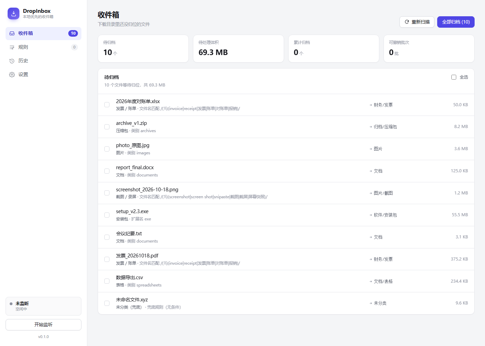
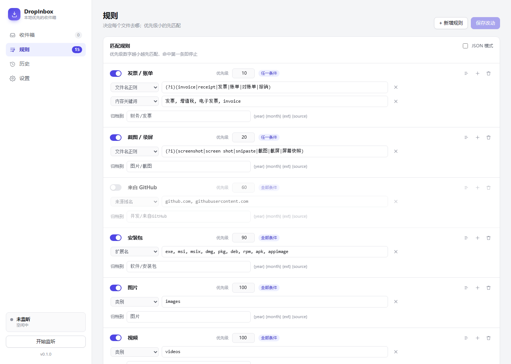
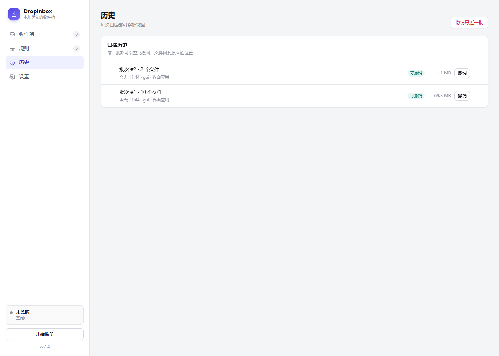
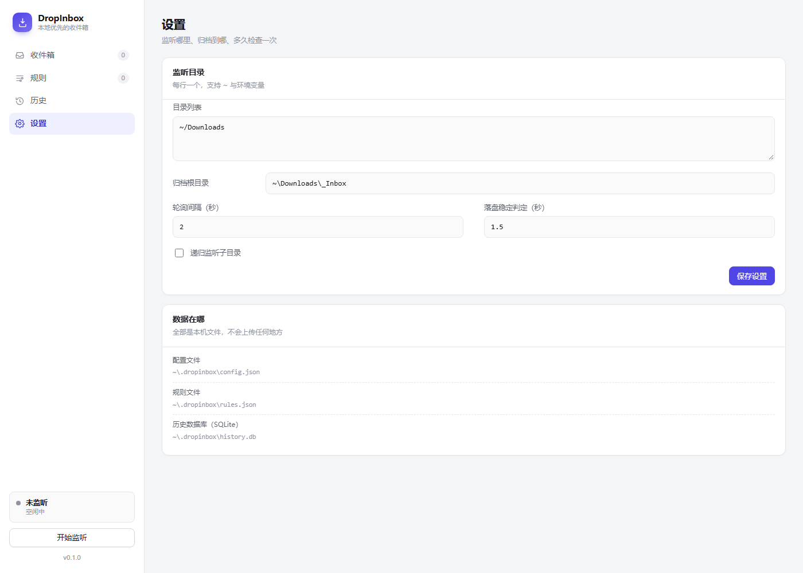

# DropInbox

**本地优先的"下载文件夹收件箱"。** 按文件类型、下载来源、内容关键词自动归档，规则可改、结果可预览、归档可一键撤销。


> A local-first inbox for your Downloads folder. Watches the directory, files by type / download source / content keywords, with editable rules, dry-run preview and one-click undo. Zero dependencies, no cloud, nothing leaves your machine.

---

## 为什么

下载文件夹和桌面永远在变乱。用过的云整理工具大多要求把文件上传，规则写死，改一次要找客服；少数本地工具又只按扩展名分文件夹，发票和截图照样混在一起。

DropInbox 只做三件事，并且把这三件事做扎实：

- **监听** 下载目录，文件写完了才动它
- **按规则归档**，规则是你能读能改的 JSON
- **随时撤销**，每一次归档都有完整记录

---

## 界面



每个文件都会告诉你：命中了哪条规则、为什么命中、要去哪个目录。

<details>
<summary>规则编辑、历史撤销、设置</summary>







</details>

---

## 快速开始

不需要安装任何第三方包，Python 3.9+ 即可。

```bash
git clone https://github.com/MoonL1ght-one/dropinbox.git
cd dropinbox

# 方式一：直接运行
python -m dropinbox init      # 写入默认配置与规则
python -m dropinbox scan      # 预览：每个文件会去哪
python -m dropinbox gui       # 打开图形界面

# 方式二：安装成命令
pip install -e .
dropinbox init
```

`init` 之后配置在 `~/.dropinbox/`：

```
~/.dropinbox/
├── config.json     监听哪些目录、归档到哪
├── rules.json      规则（可以直接用编辑器改）
└── history.db      归档记录（SQLite，撤销靠它）
```

默认监听 `~/Downloads`，归档到 `~/Downloads/_Inbox`。第一次使用建议先跑 `dropinbox scan` 看一眼打算怎么动你的文件。

---

## 命令行

| 命令 | 作用 |
| --- | --- |
| `dropinbox init` | 初始化配置与默认规则 |
| `dropinbox scan` | 预览归档计划，不移动任何文件 |
| `dropinbox apply` | 执行归档（会先问你确认） |
| `dropinbox watch` | 持续监听，下载完成即自动归档 |
| `dropinbox watch --dry-run` | 只打印计划，不实际移动 |
| `dropinbox undo` | 撤销最近一次归档 |
| `dropinbox undo --list` | 列出最近批次 |
| `dropinbox undo --batch 12` | 撤销指定批次 |
| `dropinbox rules list` | 查看启用中的规则 |
| `dropinbox rules test 某文件.pdf` | 看这个文件会被哪条规则命中 |
| `dropinbox rules export out.json` | 导出规则，方便分享 |
| `dropinbox gui` | 打开本地图形界面（127.0.0.1） |
| `dropinbox status` | 一眼看当前状态 |
| `dropinbox config set watch_dirs "~/Downloads"` | 改配置 |

---

## 规则

规则就是 `~/.dropinbox/rules.json` 里的一个数组，也可以完全在图形界面里编辑。

```json
[
  {
    "id": "invoice",
    "name": "发票 / 账单",
    "enabled": true,
    "priority": 10,
    "match_mode": "any",
    "match": {
      "name_regex": "(?i)(invoice|receipt|发票|账单|对账单)",
      "content_keywords": ["增值税", "电子发票"]
    },
    "target": "财务/发票"
  }
]
```

**优先级**：`priority` 越小越先匹配，命中第一条就停止。所以"发票"（10）可以抢在"图片"（100）之前。

**match_mode**：`all` 表示列出的条件必须全部满足，`any` 表示满足任一即可。一个条件都不写就是兜底规则，会接住所有剩余文件。

### 可用条件

| 条件 | 含义 | 示例 |
| --- | --- | --- |
| `ext` | 扩展名 | `["pdf", "docx"]` |
| `categories` | 内置类别 | `["images", "archives"]` |
| `name_regex` | 文件名正则 | `"(?i)invoice"` |
| `name_contains` | 文件名包含 | `["对账单", "报销"]` |
| `name_glob` | 文件名通配 | `["*.bak"]` |
| `content_keywords` | 文件内容关键词（读前 16KB 文本） | `["发票", "合同"]` |
| `source_domains` | 下载来源域名 | `["github.com"]` |
| `size_min` / `size_max` | 大小区间 | `"10KB"`, `"2GB"` |
| `older_than` / `newer_than` | 文件年龄 | `"2h"`, `"7d"` |

内置类别：`images` `videos` `audio` `documents` `spreadsheets` `presentations` `ebooks` `archives` `fonts` `code` `models`。

### 目标目录

`target` 相对归档根目录，支持占位符：

| 占位符 | 结果 |
| --- | --- |
| `{year}` `{month}` `{day}` | 文件修改时间，如 `2026` / `10` / `18` |
| `{ext}` | 扩展名，如 `pdf` |
| `{stem}` `{name}` | 文件名 / 文件名含扩展名 |
| `{category}` | 内置类别 |
| `{source}` | 下载来源域名 |

例如 `"文档/{year}/{ext}"` 会把 2026 年的 PDF 放进 `_Inbox/文档/2026/pdf/`。

---

## 它怎么知道文件从哪下载的

不需要联网，也不需要浏览器插件，直接读操作系统留下的下载元数据：

- **Windows**：NTFS 备用数据流 `Zone.Identifier`（浏览器下载时由系统写入）
- **macOS**：扩展属性 `com.apple.metadata:kMDItemWhereFroms`
- **Linux**：扩展属性 `user.xdg.origin.url`

读不到就安静地当作"来源未知"，不影响其他条件。这条链路可以自己验证：

```bash
dropinbox rules test ~/Downloads/某个刚下载的文件.zip
```

---

## 安全设计

让它动你的文件，得先证明它不会弄丢东西。这里的设计取舍：

- **不覆盖**：目标重名自动变成 `name (1).ext`，撤销时如果原位置已有同名新文件，同样加后缀
- **不搬半成品**：只有文件大小与修改时间连续 `settle_seconds` 不变才认为下载完成；`.crdownload` / `.part` / `~$*` 一律无视
- **不递归吃自己**：归档目录内的文件不会被再次归档
- **先预览后执行**：`scan` 是纯只读；`apply` 默认要确认；`watch` 可用 `--dry-run`
- **可完整回退**：每次归档是一个批次，`undo` 逆序搬回；归档目录被手动删掉的文件会被标记为"已不在"并跳过，不会报错中断
- **GUI 只绑本机**：仅监听 `127.0.0.1`，校验 `Host`/`Origin` 头，防止网页跨站调用本机接口

---

## 数据与隐私

没有账号、没有遥测、没有网络请求。整个程序只读写两个地方：你的监听目录，和 `~/.dropinbox/`。删掉 `~/.dropinbox/` 就等于完全卸载。

---

## 开发

```bash
python -m unittest discover -s tests -t . -v
```

33 个用例覆盖规则匹配、目标模板渲染、以及最关键的撤销行为（重名不覆盖、双重撤销、归档文件被删后仍能继续）。

项目结构：

```
dropinbox/
├── cli.py         命令行入口
├── config.py      配置与默认规则
├── rules.py       匹配引擎（条件求值、单位解析、模板渲染的调用方）
├── organizer.py   扫描、规划、执行搬运
├── history.py     SQLite 历史与撤销
├── meta.py        读取下载来源（ADS / xattr）
├── watcher.py     轮询监听与落盘稳定判定
├── server.py      本地 HTTP API
└── web/           单页界面（原生 HTML/CSS/JS，无构建）
```

界面没有框架、没有打包步骤，改完刷新浏览器就能看到效果。

---

## 路线图

- [ ] 常驻托盘 / 开机自启
- [ ] 规则支持"保留最近 N 份"与按大小清理
- [ ] 同名文件自动追加下载日期，而不是 `(1)`
- [ ] 可选 Tauri 外壳，做成单文件桌面应用
- [ ] 规则市场：导入别人分享的 JSON

---

## License

MIT
